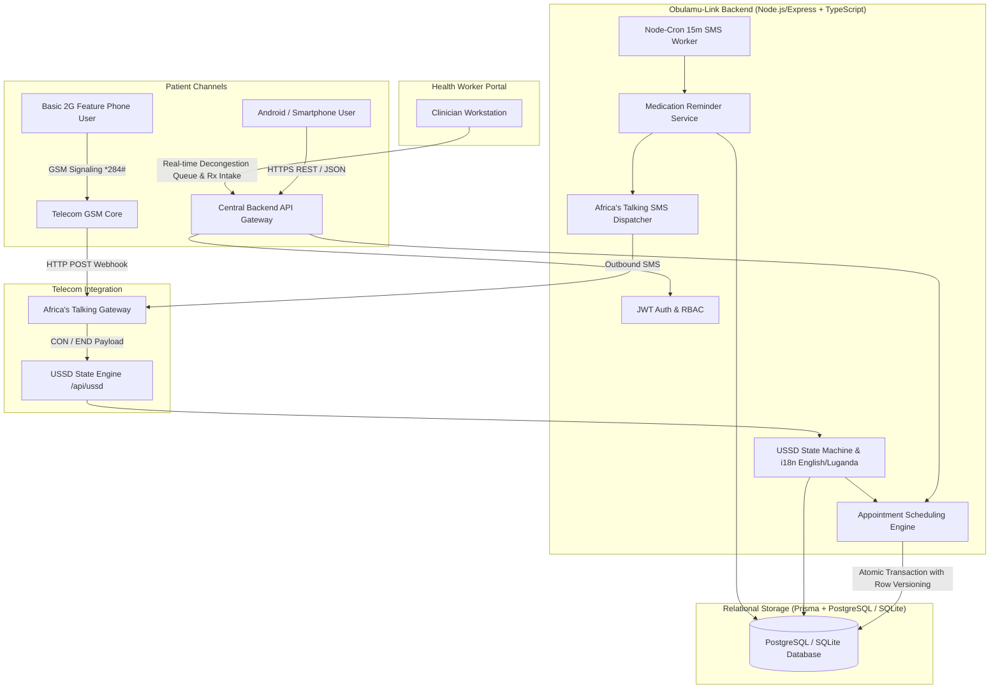

# 🏥 Obulamu-Link: Android & USSD Appointment Scheduling & Medication Reminder System
**Case Study: Kampala Public Health Clinics / Bugema University Health Centre**

[](https://www.typescriptlang.org/)
[](https://nodejs.org/)
[](https://www.prisma.io/)
[](https://africastalking.com/)
[](https://react.dev/)
[](https://www.docker.com/)

---

## 📋 1. Executive Summary & Problem Context
Public health facilities in the Kampala metropolitan area and university health centres (such as **Bugema University Health Centre**, **Kisenyi Health Centre IV**, and **Kawempe National Referral Hospital**) face two chronic logistical bottlenecks:
1. **Severe Morning Congestion (The 8:00 AM Rush):** Without scheduled arrivals, outpatients converge on clinics simultaneously at dawn. Waiting rooms experience extreme overcrowding, high nosocomial transmission risks, and clinician burnout.
2. **Follow-Up Defaults & Medication Non-Adherence:** Patients with chronic conditions (such as HIV/ART, hypertension, diabetes) and antenatal mothers frequently miss refill dates due to lack of timely reminders.
3. **The Digital Divide:** While clinical staff and urban smartphone owners have internet access, a large proportion of public health patients rely on basic 2G feature phones without mobile data.

**Obulamu-Link** solves this with a **synchronized dual-channel scheduling architecture**:
- **Channel A (Internet / Smartphone):** Modern responsive Android & Web client with interactive hourly time-slot pickers, active countdown cards, and digital queue monitors.
- **Channel B (Offline / Feature Phone):** Interactive 2G GSM USSD service (**`*284#`**) and automated SMS reminders via the **Africa's Talking** telecom gateway, with dual-language support (**English & Oluganda**).
- **Decongestion Engine:** Real-time clinician queue management that spreads outpatient volume across hourly windows (e.g. 08:00-09:00, 09:00-10:00, etc.) with strict concurrency protection against over-allocation.

---

## 🏗️ 2. System Architecture



---

## 🗄️ 3. Relational Database Schema & Entities

The relational database is configured with **Prisma ORM** supporting both zero-config local SQLite and production PostgreSQL.

| Table | Primary Attributes | Description |
|---|---|---|
| **`users`** | `id`, `phone_number`, `password_hash`, `full_name`, `role` (`PATIENT`, `CLINICIAN`, `ADMIN`), `language_pref` (`EN`, `LG`), `created_at` | Stores accounts, credentials, role permissions, and preferred language. |
| **`clinics`** | `id`, `name`, `location`, `department`, `daily_capacity`, `open_time`, `close_time` | Health facilities (e.g., Bugema HC, Kisenyi HC IV, Kawempe, Kiruddu). |
| **`appointment_slots`** | `id`, `clinic_id`, `slot_date`, `start_time`, `end_time`, `max_patients`, `booked_count`, `version` | Hourly allocation windows with optimistic locking version counter. |
| **`appointments`** | `id`, `booking_reference`, `patient_id`, `clinic_id`, `slot_id`, `booking_channel` (`ANDROID`, `USSD`), `status` (`SCHEDULED`, `COMPLETED`, `CANCELLED`, `NO_SHOW`) | Patient appointments with tracking references (e.g. `OBL-1001`). |
| **`medication_reminders`** | `id`, `appointment_id`, `patient_id`, `medication_name`, `dosage`, `reminder_date`, `channel` (`SMS`, `PUSH`), `sent_status` (`PENDING`, `SENT`, `FAILED`) | Prescribed medication regimes scheduled for SMS alerts. |
| **`ussd_sessions`** | `session_id`, `phone_number`, `current_state`, `temp_data`, `updated_at` | Active telecom session tracking. |
| **`sms_logs`** | `id`, `phone_number`, `message`, `status`, `provider_id`, `created_at` | Outbound SMS audit trail for Africa's Talking dispatches. |

---

## 🔒 4. Concurrency Safety & Race Condition Protection

To prevent slot over-allocation when multiple patients (via Android or USSD) attempt to book the last remaining spot simultaneously, Obulamu-Link enforces an **atomic transaction with optimistic locking**:

```typescript
return await prisma.$transaction(async (tx) => {
  // 1. Fetch slot with current booked count
  const slot = await tx.appointmentSlot.findUnique({
    where: { id: slotId },
    include: { clinic: true }
  });

  // 2. Strict capacity boundary check
  if (slot.bookedCount >= slot.maxPatients) {
    throw new Error('This time slot is completely booked.');
  }

  // 3. Atomically increment with version check
  const updatedSlot = await tx.appointmentSlot.update({
    where: {
      id: slotId,
      version: slot.version // Version lock
    },
    data: {
      bookedCount: { increment: 1 },
      version: { increment: 1 }
    }
  });

  if (updatedSlot.bookedCount > updatedSlot.maxPatients) {
    throw new Error('Slot exceeded capacity during race condition check.'); // Rollback
  }

  // 4. Create appointment and dispatch SMS
  return await tx.appointment.create({ /* ... */ });
});
```

---

## 📟 5. USSD State Machine Navigation Tree (`*284#`)

The USSD webhook (`POST /api/ussd`) implements the standard Africa's Talking protocol (`CON` for continuous menus, `END` for termination):

```
*284# (Root Level 0)
│
├── 1. Book Appointment
│   └── Level 1: Select Department
│       ├── 1. General Outpatient (OPD)
│       ├── 2. Chronic Care / ART Clinic
│       └── 3. Antenatal Care (MCH)
│           └── Level 2: Select Facility
│               ├── 1. Bugema University Health Centre
│               ├── 2. Kisenyi Health Centre IV
│               ├── 3. Kawempe National Referral Hospital
│               └── 4. Kiruddu National Referral Hospital
│                   └── Level 3: Select Date
│                       ├── 1. Today
│                       ├── 2. Tomorrow
│                       └── 3. Day After Tomorrow
│                           └── Level 4: Select Hourly Slot
│                               ├── 1. 08:00 - 09:00 (5 left)
│                               ├── 2. 09:00 - 10:00 (7 left)
│                               └── 3. 10:00 - 11:00 (8 left)
│                                   └── Level 5: END Confirmation
│                                       "END Booking confirmed for 16 Nov at 09:00 - 10:00.
│                                        Your Booking ID is OBL-4829. An SMS confirmation has been sent."
│
├── 2. View Scheduled Visit
│   └── Displays active booking reference, date, and clinic facility.
│
├── 3. Reschedule / Cancel
│   └── Select active booking to cancel; slot capacity is automatically released.
│
└── 4. Select Language
    ├── 1. English
    └── 2. Oluganda (Persists preference to patient record)
```

### Multilingual Support (Luganda / English)
All USSD menus and SMS alerts are available in both **English** and **Oluganda**:
- *Luganda Confirmation:* `"END Enteekateeka ekakasiddwa ku 16 Nov essaawa 09:00 mu Bugema University Health Centre. Ennamba yo eri: OBL-4829. Obubaka bwa SMS bwoherezeddwa."`
- *Luganda Medication Alert:* `"Obulamu-Link OKUJUKIZA EDDAGALA: Jjukira okumira eddagala lyo: TLD (1 tablet daily at 8:00 PM). Obulamu bwe bugagga!"`

---

## ⏰ 6. Africa's Talking SMS Worker & Cron Engine

A background scheduler (`src/cron/reminder.cron.ts`) runs every **15 minutes** via `node-cron`:
1. **24-Hour Appointment Alerts:** Queries appointments scheduled for tomorrow that haven't received a reminder (`reminderSent = false`), dispatches localized SMS reminders, and marks `reminderSent = true`.
2. **Medication Regimen Adherence:** Queries pending reminders for today (`sentStatus = 'PENDING'`), dispatches localized dosage instructions via Africa's Talking, and marks `sentStatus = 'SENT'`.
3. **Simulation Mode:** For development or offline environments without active telecom balances, outbound messages are logged to the `SMSLog` database table and streamed to the UI in real time.

---

## 🚀 7. Quickstart & Installation

### Option 1: Running with Docker Compose (Recommended)
```bash
# Clone and navigate to project root
cd Obulamu-link

# Start PostgreSQL, Backend API, and Frontend web application
docker-compose up --build
```
- **Web Frontend:** `http://localhost:5173`
- **Backend API:** `http://localhost:5001`
- **USSD Webhook:** `http://localhost:5001/api/ussd`

---

### Option 2: Running Locally with Node.js & npm

#### 1. Setup Backend:
```bash
cd backend
npm install

# Initialize database schema and generate Prisma client
npx prisma db push

# Seed Kampala clinics, clinicians, slots, and test appointments
npm run prisma:seed

# Start backend server
npm run dev
```

#### 2. Setup Frontend:
```bash
cd ../frontend
npm install
npm run dev
```
Open `http://localhost:5173` in your browser.

---

## 🔑 8. Default Seed Credentials for Demo

| Role | Name | Phone Number | Password |
|---|---|---|---|
| **Clinician (Doctor)** | Dr. Sarah Namubiru | `+256772100100` | `Password123!` |
| **Clinician (Doctor)** | Dr. David Mukasa | `+256772200200` | `Password123!` |
| **Patient (Luganda)** | Mary Nakato | `+256701334455` | `Password123!` |
| **Patient (English)** | John Baptist Kato | `+256782556677` | `Password123!` |

---

## 📡 9. REST API Specification

### Authentication
- `POST /api/auth/register` — Register a patient or clinician.
- `POST /api/auth/login` — Authenticate and receive JWT.
- `GET /api/auth/me` — Retrieve active profile.

### Clinics & Hourly Slots
- `GET /api/clinics` — List all facilities (Bugema, Kisenyi, Kawempe, Kiruddu).
- `GET /api/clinics/slots?clinicId=:id&date=YYYY-MM-DD` — Get available hourly slots and remaining capacities.

### Appointments & Queue
- `POST /api/appointments/book` — Atomic slot booking (Patient or Clinician).
- `GET /api/appointments/my` — Get authenticated patient's active visits.
- `GET /api/appointments/clinician/queue/today?clinicId=:id&date=YYYY-MM-DD` — Real-time outpatient queue and hourly distribution histogram.
- `PATCH /api/appointments/:id/status` — Mark status (`COMPLETED`, `NO_SHOW`, `CANCELLED`).

### Medication Reminders & SMS
- `POST /api/reminders/create` — Clinician schedules automated follow-up medication alerts.
- `POST /api/reminders/trigger-cron` — Manually trigger the 15-minute SMS reminder dispatcher.
- `POST /api/ussd` — Africa's Talking USSD webhook endpoint.
- `GET /api/ussd/sms-logs` — Real-time outbound SMS feed.

---

## 📱 10. Interactive 2G Feature Phone Simulator
The frontend includes a built-in virtual **GSM Feature Phone Simulator** (Nokia 3310 style with monochrome LCD display and telephone keypad):
1. Navigate to the **USSD (*284#)** tab in the UI.
2. Dial `*284#` using the on-screen keypad or click **CALL**.
3. Read the live USSD menus on the LCD screen, type numeric choices (`1`, `2`, `3`), and confirm.
4. Watch the simulated Africa's Talking SMS confirmation instantly arrive in the live SMS feed!

---

## 📄 License
MIT License. Built for public health clinics and community healthcare systems in Uganda.
